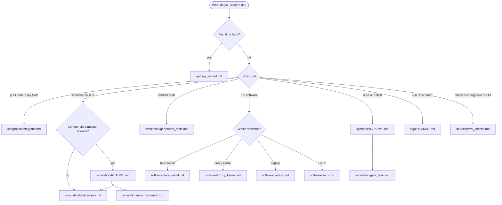

# Tutorials

Task-oriented guides to the CVA6 repository, sorted by use. Each page
covers one job and explains how the steps fit together. The options of
every recipe are in the reference, [flows/README.md](../flows/README.md).

Read [getting_started.md](getting_started.md) first. Every other page
assumes it is done.

## Which tutorial for me

## All tutorials

| Use | Tutorial |
|---|---|
| Install the repository, the tools and `cook.py` (everybody, first) | [getting_started.md](getting_started.md) |
| **Integration** | |
| Integrate CVA6 in a SoC: RTL, file lists, configuration, bus | [integration/integrator.md](integration/integrator.md) |
| **Simulation** | |
| Choose between the two testbenches | [simulation/README.md](simulation/README.md) |
| UVM testbench: VCS, Questa, Xcelium | [simulation/uvm_testbench.md](simulation/uvm_testbench.md) |
| TestHarness: Verilator, VCS, Questa, Xcelium | [simulation/testharness.md](simulation/testharness.md) |
| Run many tests with a testlist | [simulation/testlists.md](simulation/testlists.md) |
| Waveforms, GUI and debug options | [simulation/waveforms_and_debug.md](simulation/waveforms_and_debug.md) |
| CoreMark and Dhrystone | [simulation/benchmarks.md](simulation/benchmarks.md) |
| Random tests with riscv-dv | [simulation/generated_tests.md](simulation/generated_tests.md) |
| Simulate the synthesised netlist | [simulation/gate_level.md](simulation/gate_level.md) |
| **Software** | |
| A bare metal program | [software/bare_metal.md](software/bare_metal.md) |
| A program under the proxy kernel (pk) | [software/proxy_kernel.md](software/proxy_kernel.md) |
| A Zephyr application | [software/zephyr.md](software/zephyr.md) |
| Linux | [software/linux.md](software/linux.md) |
| **Synthesis** | |
| Choose a synthesis flow | [synthesis/README.md](synthesis/README.md) |
| Yosys, no licence | [synthesis/yosys.md](synthesis/yosys.md) |
| Design Compiler: GTECH or your PDK | [synthesis/dc_shell.md](synthesis/dc_shell.md) |
| **FPGA** | |
| Build a bitstream, program a board, boot Linux or Zephyr | [fpga/README.md](fpga/README.md) |
| **Development** | |
| Formatting, lint, baselines, full regression, reports | [developer/ci_checks.md](developer/ci_checks.md) |

## Other references

- [flows/QUICKSTART.md](../flows/QUICKSTART.md): worked command sequences to copy.
- [flows/README.md](../flows/README.md): every recipe and its options.
- [config/README.md](../config/README.md): the targets (configurations) and how to add one.
- [flows/CONTINUOUS_INTEGRATION.md](../flows/CONTINUOUS_INTEGRATION.md): the reports and the CI pipelines.
- [corev_apu/instr_tracing/README.md](../corev_apu/instr_tracing/README.md): instruction tracing.
