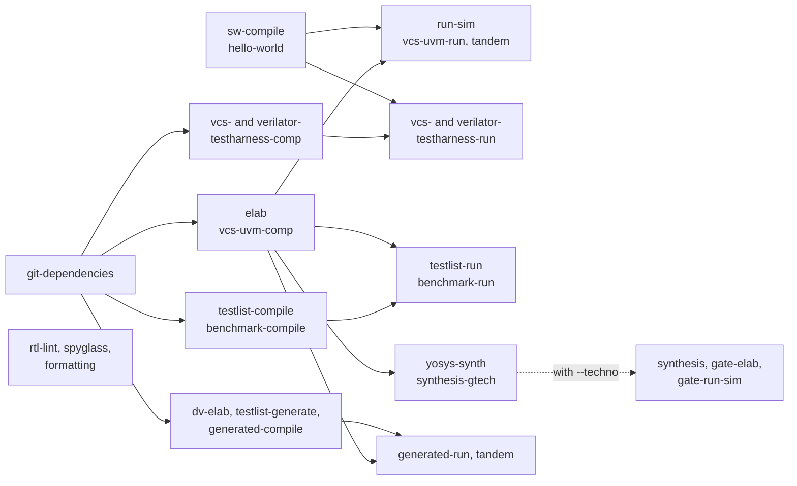

# Changing CVA6 and checking it like the CI

Purpose: for the contributor, what to run before a pull request, how the
baselines work, and how to replay the CI on a workstation.

**Prerequisites:** [getting_started.md](../getting_started.md). The
contribution rules of the project are in [CONTRIBUTING.md](../../CONTRIBUTING.md).

## Before a pull request

Run the open-source checks of the CI on every target. They need no
licence and no FPGA board, and take about 25 minutes with 16 jobs on an
18-core machine:

```bash
./cook.py full-regression --open-source -j 16
```

It runs the formatting checks, `rtl-lint` and `yosys-synth` of every
target, hello-world on the Verilator TestHarness of the AXI targets, and
the documentation. Then open `artifacts/reports/pipeline_report.html`
(see [Reading the results](#reading-the-results)). To check only the
targets you changed, add `-t <target>`. The job list is in
[Open-source mode](../../flows/CONTINUOUS_INTEGRATION.md#open-source-mode).

## Formatting

The CI checks the formatting. Run these before you push:

```bash
./cook.py verible-rtl-formating -t cv32a60x   # RTL of core/, in place
./cook.py black-python-formating              # Python of flows/, pd/, perf-model/
./cook.py pylint-run                          # Python of flows/, must stay 10.00/10
```

- `verible-rtl-formating` reformats the files of `core/` (not the
  submodules) in place, and fails when a file needed it: the list is in
  `build/<t>/verible/verible-check.log`. Commit the reformatted files.
- `black-python-formating` checks and prints the diff; it does not
  rewrite. Run `black <file>` to apply it.
- `black-python-formating` and `pylint-run` read the files known to
  `git` at `HEAD`: `git add` and commit a new Python file before checking
  it.

See [Static Analysis](../../flows/README.md#static-analysis).

## Lint

`rtl-lint` lints a target with slang, then Verilator in lint mode. It
needs no licence, and the CI runs it on every target:

```bash
./cook.py rtl-lint -t cv32a65x
```

The result is compared with the baseline
`config/target/<t>/expected_lint.yml`, the number of diagnostics per tool,
severity and rule. Any error fails; a new rule or a higher count fails
too. A lower count passes. When you fix warnings, lower the baseline in
the same commit:

```bash
./cook.py rtl-lint -t cv32a65x --update-baseline
```

Spyglass works the same way, with `expected_spyglass.rpt`, on the targets
the CI lists ([synthesis/README.md](../synthesis/README.md#spyglass-lint)).

## Baselines of performance and area

`config/target/<t>/expected_values.yml` holds the reference figures of a
target:

| Key | Checked by | Tolerance |
|---|---|---|
| `coremark_cycle`, `dhrystone_cycle` | `vcs-uvm-run` of the benchmark | exact |
| `gates` | `dc-shell-synth --techno` | 5 % |
| `gtech_cells`, `gtech_registers` | `dc-shell-synth --gtech` | 5 % |
| `yosys_cells`, `yosys_registers` | `yosys-synth` | 5 % |
| `fpga_luts`, `altera_alms` | the FPGA builds | 2 % |

A change that moves one of them on purpose updates the key in the same
commit, with the reason in the commit message. To measure the cycles, see
[simulation/benchmarks.md](../simulation/benchmarks.md). Reference:
[expected_values.yml](../../config/README.md#expected_valuesyml).

## The full regression on a workstation

The CI pipeline is one macro, `full-regression`. It runs the same
recipes, in the same order, in the current checkout. First see what it
would run here:

```bash
./cook.py full-regression --dry-run
```

Then run it, on every target or on some:

```bash
./cook.py full-regression -t cv32a65x -t profile_perf32_axi -j 16
```

It runs `git-dependencies` first, then, for each target, the software
builds, the UVM runs on VCS (with the stalling memory for OBI targets),
the TestHarness for AXI targets, the testlists, the benchmarks against
their baselines, `rtl-lint`, `yosys-synth` and the formatting checks. Some
targets also run the generated tests, pk, Zephyr, the GTECH synthesis,
Spyglass, the documentation or the FPGA images.

The jobs of one target, simplified (an AXI target; `--dry-run` prints the
real list and the dependencies):



An OBI target has no TestHarness jobs; it gets `run-sim-stall` instead,
the same run against the memory stalls of the OBI agent. The generated
tests, pk, Zephyr, GTECH, Spyglass, documentation and FPGA jobs exist only
for the targets listed in `flows/macros/full_regression.py`.

Options to fit your machine:

- `-j`: recipes running at the same time;
- `--vcs-licenses`, `--spyglass-licenses`, `--synth-licenses`,
  `--vivado-licenses`: one cap per licence pool;
- `--no-fpga`: no Vivado or no board here (`--altera` adds the
  Intel/Altera images);
- `--techno <name>`: adds the synthesis on a technology and the
  gate-level simulation;
- `--docs-targets`, `--spyglass-targets`, `--gtech-targets`,
  `--synth-targets`: a list of targets, `all` or `none`;
- `--open-source`: only the open-source jobs, see
  [Before a pull request](#before-a-pull-request).

A failing job never stops the others: the whole pipeline runs, and the
jobs that depend on a failure are skipped. With `-j` above 1 the recipes
run quietly; each keeps its full output in its own report.

Details, licence pools and how to add a job:
[The full-regression macro](../../flows/CONTINUOUS_INTEGRATION.md#the-full-regression-macro).

## Reading the results

`full-regression` ends with these two recipes, which can also be run by
hand after any set of recipes:

```bash
./cook.py merge-reports        # every build/**/cook_report.yml -> artifacts/reports/pipeline_report.yml
./cook.py report-html          # -> artifacts/reports/pipeline_report.html
```

Open `artifacts/reports/pipeline_report.html` in a browser: it is the
dashboard of the CI, a single file with no server. For one recipe, read
its `cook_report.yml` (`status`, `fail_kind`, metrics), see
[Reports](../../flows/README.md#reports).

## The CI of the repository

Two pipelines run the same recipes:

- **GitLab**: the `full regression` job runs the macro on a runner
  carrying the commercial tools and the FPGA board, then publishes the
  dashboard. Adding a target or a testlist is a change in
  `flows/macros/full_regression.py`, not in `.gitlab-ci.yml`.
- **GitHub Actions**: the TestHarness smoke
  (`.github/workflows/cook-testharness-smoke.yml`) runs on the pull
  requests to `master_candidate`. It builds the Verilator TestHarness of
  `profile_perf32_axi` and runs two Hello tests. It needs no licence, so
  you can replay it locally.

How each one works, its variables, and how to replay the smoke:
[CONTINUOUS_INTEGRATION.md](../../flows/CONTINUOUS_INTEGRATION.md).

## Changing the flows

Adding or changing a recipe of `cook.py`:
[flows/CONTRIBUTING.md](../../flows/CONTRIBUTING.md). Adding a target:
[config/README.md](../../config/README.md#creating-a-new-target).

## Instruction tracing

The instruction trace encoder of `corev_apu` (ITI, encoder,
encapsulator, decoder) has its own documentation and scripts:
[corev_apu/instr_tracing/README.md](../../corev_apu/instr_tracing/README.md).

## See also

- [simulation/README.md](../simulation/README.md): run and debug one test
- [simulation/generated_tests.md](../simulation/generated_tests.md): random tests
- [flows/README.md](../../flows/README.md): every recipe
