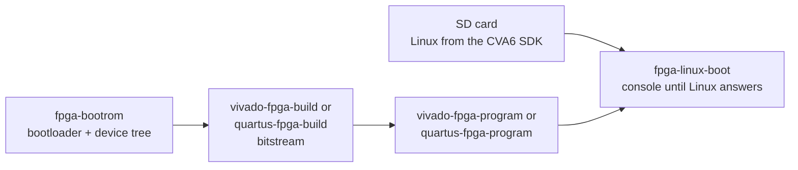

# CORE-V APU on FPGA

Purpose: run CVA6 on a board: build the bitstream, program the board,
boot Linux or Zephyr, and debug with OpenOCD.

**Prerequisites:** [getting_started.md](../getting_started.md), Vivado
(Xilinx) or Quartus Prime Pro (Intel/Altera) with a licence covering the
device, `dtc`, and a GCC toolchain in `compiler.yml`. Vivado version and
licence: [Vivado prerequisites](../../flows/README.md#vivado-prerequisites).

## Boards

| Board | Vendor | Targets | Recipes |
|---|---|---|---|
| [Genesys 2](https://reference.digilentinc.com/reference/programmable-logic/genesys-2/reference-manual) | Xilinx Kintex-7 | `fpga_linux_cv32a6`, `fpga_linux_cv64a6` | `vivado-fpga-*` |
| [Agilex 7 Development Kit](https://www.intel.la/content/www/xl/es/products/details/fpga/development-kits/agilex/agf014.html) | Intel/Altera | `fpga_linux_cv64a6` | `quartus-fpga-*` |

`kc705`, `vc707` and `nexys_video` also build with `vivado-fpga-build
--board`, but cannot be programmed by the recipes yet. Pre-built
bitstreams for the Genesys 2 are attached to the
[releases](https://github.com/openhwgroup/cva6/releases).

The Genesys 2 design (`ariane_xilinx`, Vivado 2018.2) contains a DDR3
controller, an SPI controller for the SD card, an Ethernet controller (not
functional yet), the JTAG debug port, a boot ROM with the zero stage
bootloader and the device tree, a UART and GPIOs on the LEDs.

The Agilex 7 design (`cva6_altera`, Quartus Prime Pro 24.1) contains a
DDR4 controller, the JTAG debug port, the boot ROM, a JTAG UART and GPIOs
on the LEDs.

## The chain



## Genesys 2: the four steps

```bash
# 1. The zero stage bootloader, with the device tree of the board
./cook.py fpga-bootrom -t fpga_linux_cv64a6 -c gcc-15 --board genesys2

# 2. The bitstream (the first build also generates the Vivado IPs)
./cook.py vivado-fpga-build -t fpga_linux_cv64a6 --board genesys2

# 3. Load it into the FPGA, through a running hw_server
./cook.py vivado-fpga-program -t fpga_linux_cv64a6 --hw-server localhost:3121

# 4. Follow the console until Linux answers
./cook.py fpga-linux-boot -t fpga_linux_cv64a6 --uart /dev/ttyUSB0
```

| Step | Output |
|---|---|
| `fpga-bootrom` | `build/bootrom/genesys2/rv64/bootrom_64.sv`: one ROM per board and register width, shared by the targets of that width |
| `vivado-fpga-build` | `build/fpga_linux_cv64a6/fpga/genesys2/ariane_xilinx.bit`, the utilization and timing reports |
| `vivado-fpga-program` | `build/fpga_linux_cv64a6/fpga_program/genesys2/` |
| `fpga-linux-boot` | `build/fpga_linux_cv64a6/fpga_boot/genesys2/boot.log`, the console transcript |

Each step checks the output of the previous one, so steps 3 and 4 can be
replayed without rebuilding. `vivado-fpga-program` only loads the FPGA
(volatile). Use `fpga_linux_cv32a6` for the 32-bit image.

The RTL of the image is `config/target/<t>/Flist.cva6_fpga`, which
includes `corev_apu/fpga/Flist.cva6_fpga`. Options:
[FPGA](../../flows/README.md#fpga).

### Flash the configuration memory

To keep the image across power cycles, build the flash image too:

```bash
./cook.py vivado-fpga-build -t fpga_linux_cv64a6 --mcs
```

then write `ariane_xilinx.mcs` in the Vivado hardware manager: open the
board (`xc7k325t`), Tools, Add Configuration Memory Device, select the
Spansion SPI flash `s25fl256xxxxxx0`, add the `.mcs`, and press OK.
Flashing takes a few minutes. Then right click on the FPGA device, Boot
from Configuration Memory Device (or press the program button of the
board).

## Booting Linux

The bootloader loads Linux from the SD card. Get an image from the
[CVA6 SDK](https://github.com/openhwgroup/cva6-sdk) and prepare the card
as its README explains (GPT partition for the payload). Insert the card,
program the board, then run `fpga-linux-boot`, or connect a terminal to
the USB serial port of the board:

```bash
screen /dev/ttyUSB0 115200
```

The console runs at 115200 baud. The default user is `root`, without
password. `fpga-linux-boot` answers the shell prompt with `uname -a` and
passes when the kernel answers. A board that prints nothing is reported
as an environment failure (console, power, SD card).

## Agilex 7

The same steps, with the Quartus recipes. The bootloader recipe is the
same.

```bash
./cook.py fpga-bootrom -t fpga_linux_cv64a6 -c gcc-15 --board agilex7
./cook.py quartus-fpga-build -t fpga_linux_cv64a6 --board agilex7
./cook.py quartus-fpga-program -t fpga_linux_cv64a6
./cook.py fpga-linux-boot -t fpga_linux_cv64a6 --board agilex7
```

- The image is in `build/fpga_linux_cv64a6/fpga_altera/agilex7/output_files/`
  (`.sof`, and `cva6-hps.rbf`, the file the HPS boots the fabric from).
- `quartus-fpga-program` uses a local JTAG cable. `--cable` names it
  (for example `"AGF FPGA Development Kit [1-3]"`); without it the recipe
  asks `jtagconfig`.
- The console of this board is a JTAG UART, not a serial port:
  `fpga-linux-boot` reads it with the `juart-terminal` of Quartus, and
  takes `--cable` instead of `--uart`.
- The bootloader reads the payload from the SD card at block 0x32800
  (100 MB), not from a GPT partition.

`FpgaEn` in `rtl_cfg_pkg.sv` selects the FPGA memories, and `FpgaAlteraEn`
the Altera ones (`fpga_linux_cv64a6` sets only `FpgaEn`). Building the
image needs a Quartus Pro licence. Details:
[Intel/Altera boards](../../flows/README.md#intelaltera-boards).

## A board on another machine

The board is often cabled to a bench PC while the flows run on a server.
Only the programming and the boot need the board, and both reach it over
TCP: `hw_server` (shipped with Vivado) for the JTAG, a serial-to-TCP
bridge for the console.

```bash
./cook.py vivado-fpga-program -t fpga_linux_cv64a6 --hw-server bench-pc:3121
./cook.py fpga-linux-boot -t fpga_linux_cv64a6 --uart socket://bench-pc:4001
```

Bridges, SSH tunnels and the variables `HW_SERVER_URL` and `UART_SERIAL`:
[Driving a board attached to another machine](../../flows/README.md#driving-a-board-attached-to-another-machine).

## Zephyr on the board

Zephyr supports the CVA6 SoC on the Genesys 2:
[cv64a6_genesys_2](https://docs.zephyrproject.org/latest/boards/openhwgroup/cv64a6_genesys_2/doc/index.html)
for `fpga_linux_cv64a6` and
[cv32a6_genesys_2](https://docs.zephyrproject.org/latest/boards/openhwgroup/cv32a6_genesys_2/doc/index.html)
for `fpga_linux_cv32a6`. Program the board with the image of the matching
target, as above.

Build the application with the `zephyr-build` recipe, as for the
simulation ([software/zephyr.md](../software/zephyr.md)): the board follows from the
target, and the build needs no west. The recipe requires an application
that writes `tohost`, the end of a simulation; on the board nothing reads
it. The Hello world of the repository is such an application:

```bash
./cook.py git-dependencies --repo zephyr
./cook.py zephyr-hello-world -t fpga_linux_cv64a6 -c zephyr-sdk
```

For your own application, `zephyr-build --app <dir> --out <name>`. The
build directory is `build/fpga_linux_cv64a6/compile/zephyr-hello-world/zephyr_build/`,
with `zephyr/zephyr.elf` and `zephyr/zephyr.bin`.

Load the ELF through OpenOCD and GDB (see [Debugging](#debugging)):

```bash
riscv-none-elf-gdb build/fpga_linux_cv64a6/compile/zephyr-hello-world/zephyr-hello-world.elf
(gdb) target remote localhost:3333
(gdb) load
(gdb) continue
```

Or boot it from the SD card: the zero stage bootloader loads and runs the
binary of the first partition, which `util/write-zephyr-sd.sh` writes:

```bash
./util/write-zephyr-sd.sh /dev/sdXXX \
  build/fpga_linux_cv64a6/compile/zephyr-hello-world/zephyr_build/zephyr/zephyr.bin
```

**The script wipes the partition table and all data of the card. Check
the device path.**

The Zephyr documentation of the boards
([cv64a6_genesys_2](https://docs.zephyrproject.org/latest/boards/openhwgroup/cv64a6_genesys_2/doc/index.html),
[cv32a6_genesys_2](https://docs.zephyrproject.org/latest/boards/openhwgroup/cv32a6_genesys_2/doc/index.html))
also describes a build with west, `west flash` and `west debug`.

## Debugging

### Genesys 2

Debug (and program) the FPGA with [OpenOCD](http://openocd.org/doc/html/Architecture-and-Core-Commands.html).
Connect the micro USB port labelled JTAG. Its FTDI 2232 chip carries the
JTAG of the FPGA and, on its second channel, the JTAG of the RISC-V debug
module.

On Ubuntu, add this udev rule to `/etc/udev/rules.d/99-ftdi.rules`:

```
SUBSYSTEM=="usb", ACTION=="add", ATTRS{idProduct}=="6010", ATTRS{idVendor}=="0403", MODE="664", GROUP="plugdev"
```

`lsusb` should list the chip:

```
Bus 005 Device 019: ID 0403:6010 Future Technology Devices International, Ltd FT2232C/D/H Dual UART/FIFO IC
```

Then start OpenOCD with the configuration of the repository:

```
openocd -f corev_apu/fpga/ariane.cfg
...
Info : Examined RISC-V core; found 1 harts
Info :  hart 0: XLEN=64, misa=0x8000000000141105
Info : Listening on port 3333 for gdb connections
```

### Agilex 7

Use the OpenOCD shipped with Quartus
(`$quartus_installation_path/qprogrammer/quartus/bin/openocd`). Connect
the micro USB port J13, the same as the UART. Both go through the JTAG
interface to the System Level Debugging (SLD) hub of the FPGA, and the
debugger reaches the core through a virtual JTAG IP.

```
$quartus_installation_path/qprogrammer/quartus/bin/openocd -f corev_apu/altera/altera.cfg
...
Info : Examined RISC-V core; found 1 harts
Info : starting gdb server for agilex7.cva6.0 on 3333
```

The console of a program is read with the JTAG UART terminal of Quartus:

```
$quartus_installation_path/qprogrammer/quartus/bin/juart-terminal
juart-terminal: connected to hardware target using JTAG UART on cable
juart-terminal: "AGF FPGA Development Kit [1-3]", device 1, instance 0
Hello World!
```

### Both boards

Connect with `telnet` on port 4444 or with GDB:

```
riscv-none-elf-gdb /path/to/elf
(gdb) target remote localhost:3333
(gdb) load
(gdb) b putchar
(gdb) c
(gdb) p/x $mepc
```

Read and write the memory of the device:

```
(gdb) x/i 0x1000
(gdb) set {int} 0x1000 = 22
(gdb) set $pc = 0x1000
```

## Re-generating the bootcode (ZSBL)

There are two zero stage bootloaders:

- **FPGA**: sources in `corev_apu/fpga/src/bootrom/`. It initialises the
  board, loads the payload from the SD card and passes the hart id and the
  address of the device tree in `a0` and `a1`. `fpga-bootrom` rebuilds it:
  it resolves the device tree `cv<XLEN>a6.dts.in` (or
  `cv<XLEN>a6_agilex.dts.in`) with the parameters of the board, compiles it
  with `dtc`, compiles the bootloader with `sw-compile`, and turns the ELF
  into `bootrom_<XLEN>.sv` with `corev_apu/bootrom/gen_rom.py`.
  `vivado-fpga-build` and `quartus-fpga-build` read it from
  `build/bootrom/<board>/rv<XLEN>/`. See
  [`fpga-bootrom`](../../flows/README.md#fpga-bootrom).
- **Simulation** (TestHarness): `corev_apu/bootrom/bootrom.sv`, generated
  from `bootrom.S` and `ariane.dts` by the `Makefile` of that directory.
  It jumps to the base of the DRAM. No recipe rebuilds it.

## OpenPiton cache system

CVA6 has preliminary support for the OpenPiton distributed cache system:
`core/cache_subsystem/cva6_hpdcache_subsystem_l15_adapter.sv`, selected by
the `NOCType` parameter (`NOC_TYPE_L15_BIG_ENDIAN` or
`NOC_TYPE_L15_LITTLE_ENDIAN`). The adapter is not connected to the
HPDcache subsystem yet, and no target uses it. See the
[OpenPiton repository](https://github.com/PrincetonUniversity/openpiton).

## See also

- [flows/README.md, FPGA](../../flows/README.md#fpga): every option
- [flows/QUICKSTART.md, FPGA](../../flows/QUICKSTART.md#fpga)
- [software/zephyr.md](../software/zephyr.md): Zephyr in simulation
- [software/linux.md](../software/linux.md): where the Linux image comes from
