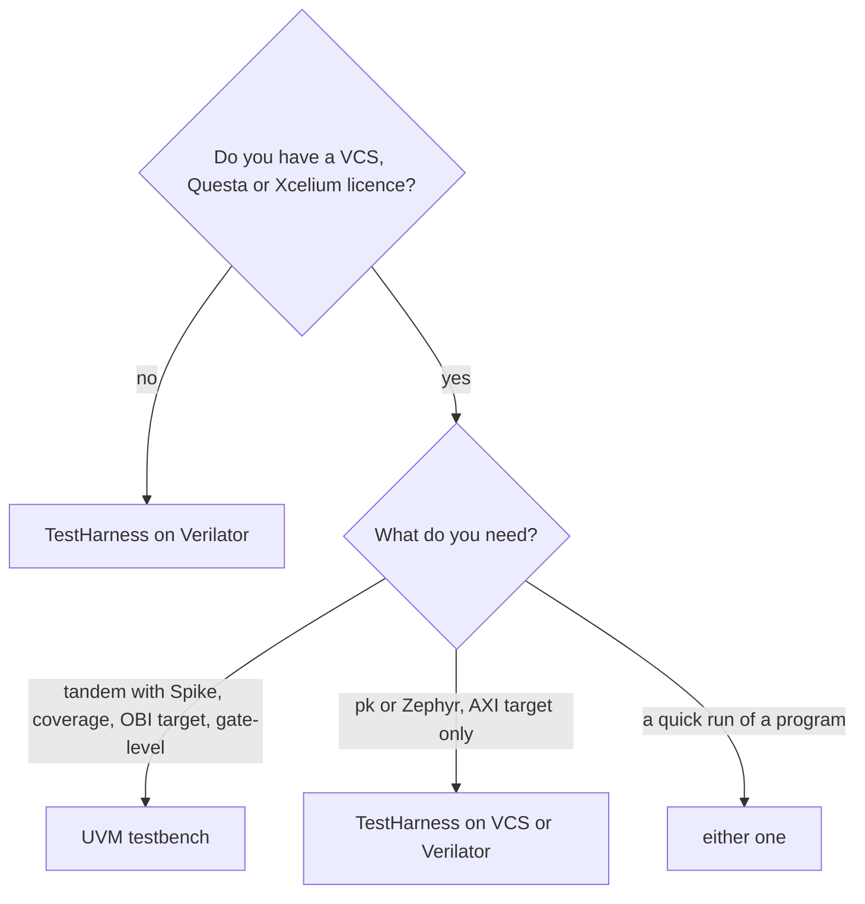

# Choose a testbench

Purpose: pick the testbench, and so the tutorial, that fits your job and
your simulator.

**Prerequisites:** [getting_started.md](../getting_started.md) (Spike
installed, `git-dependencies` run, a toolchain in `compiler.yml`).

CVA6 runs in two separate testbenches. They are not two modes of one
testbench: the sources, the tops, the recipes and the output directories
are separate. A design elaborated for one cannot run a test of the other.
The compiled programs are shared: a test built by `sw-compile` runs on
both.

| | UVM testbench | TestHarness |
|---|---|---|
| Tutorial | [uvm_testbench.md](uvm_testbench.md) | [testharness.md](testharness.md) |
| Sources | `verif/tb/uvmt/`, agents of `verif/core-v-verif` | `corev_apu/tb/` (a small AXI SoC) |
| Targets | all (AXI and OBI) | AXI targets only (`hier: axi`) |
| Verdict | UVM scoreboard, optional Spike tandem | the `tohost` value written by the program |
| Extras | Spike tandem, coverage, gate-level, OBI stalls, benchmarks with `--stats` | proxy kernel, Zephyr, no licence with Verilator |
| Compilation modes | `rtl`, `coverage`, `gate_wc_timing`, `gate_wc_power` | `rtl` only |
| Recipes | `<sim>-uvm-comp`, `<sim>-uvm-run`, `uvm-run-testlist`, `vcs-uvm-gui` | `<sim>-testharness-comp`, `<sim>-testharness-run`, `testharness-run-testlist` |

Simulators per testbench. "Not verified" means the recipe exists but was
never run to the end of a test: expect to fix it on first use.

| Simulator | UVM testbench | TestHarness |
|---|---|---|
| VCS | verified | verified |
| Questa | verified | not verified |
| Xcelium | not verified | not verified |
| Verilator | no | verified, no licence |

The UVM testbench is the one the verification of CVA6 relies on. The
TestHarness is the way in without a commercial simulator, and the one
that runs pk and Zephyr. Details:
[Current Status](../../flows/README.md#current-status).

## Topics common to both testbenches

- [testlists.md](testlists.md): many tests at once.
- [waveforms_and_debug.md](waveforms_and_debug.md): trace modes per
  simulator, GUI, seeds, timeouts.
- [benchmarks.md](benchmarks.md): CoreMark and Dhrystone (UVM testbench).
- [generated_tests.md](generated_tests.md): random tests with riscv-dv
  (UVM testbench, VCS).
- [gate_level.md](gate_level.md): simulation of the netlist (UVM
  testbench).

## See also

- [flows/README.md, RTL Simulation](../../flows/README.md#rtl-simulation)
- [flows/README.md, TestHarness](../../flows/README.md#rtl-simulation-testharness-testbench)
- [software/bare_metal.md](../software/bare_metal.md): build your own program
