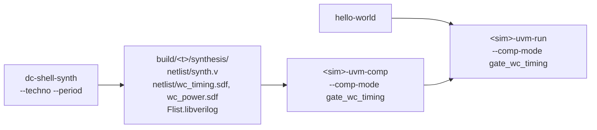

# Gate-level simulation

Purpose: run a test on the netlist produced by Design Compiler, with the
timing of a corner, on the UVM testbench.

**Prerequisites:** a netlist from `dc-shell-synth --techno ... --period
...` ([synthesis/dc_shell.md](../synthesis/dc_shell.md#on-your-pdk)), and
the UVM flow of [uvm_testbench.md](uvm_testbench.md).

Gate-level simulation exists on the **UVM testbench only**. The
TestHarness recipes accept `--comp-mode rtl` only. The Yosys and GTECH
syntheses give no netlist to simulate: they map on generic cells without
timing.

## The flow



The elaboration reads:

- `build/<t>/synthesis/Flist.libverilog`: the Verilog models of the cells,
  the `LIB_VERILOG` key of your `techno.yml`;
- `config/target/<t>/Flist.cva6_gate`: the packages and the netlist
  `build/<t>/synthesis/netlist/synth.v`, instead of the RTL;
- the SDF of the corner: `wc_timing.sdf` for `gate_wc_timing`,
  `wc_power.sdf` for `gate_wc_power`, annotated on the core instance of
  the testbench.

The elaboration refuses to start when one of these files is missing, and
prints the synthesis command to run.

## VCS

```bash
./cook.py hello-world -t cv32a60x -c gcc-15
./cook.py vcs-uvm-comp -t cv32a60x --comp-mode gate_wc_timing
./cook.py vcs-uvm-run -t cv32a60x -n hello-world --comp-mode gate_wc_timing
```

The SDF is given to `vcs` with `-sdf` at elaboration. `gate_wc_power`
uses the power corner instead. Outputs in
`build/<t>/elab/sim_gate_wc_timing/` and
`build/<t>/simulation/sim_gate_wc_timing/`. This is the simulation the
full regression runs when it is given `--techno`.

## Questa

```bash
./cook.py questa-uvm-comp -t cv32a60x --comp-mode gate_wc_timing
./cook.py questa-uvm-run -t cv32a60x -n hello-world --comp-mode gate_wc_timing
```

The recipe compiles the netlist and the cell models instead of the RTL.
It also writes an SDF command (`sdf load`) in
`build/<t>/elab/sim_gate_wc_timing/sdf.do`, but today neither `vopt` nor
the `vsim` of `questa-uvm-run` reads that file: the run is a gate-level
simulation **without timing annotation**. To annotate, add the SDF to the
simulation yourself (for instance with `--run_opts`), and check in the
log that it is applied. The CI does not exercise this mode.

## Xcelium (not verified)

```bash
./cook.py xcelium-uvm-comp -t cv32a60x --comp-mode gate_wc_timing
./cook.py xcelium-uvm-run -t cv32a60x -n hello-world --comp-mode gate_wc_timing
```

The recipe writes an SDF command file, `sdf.cmd`, given to `xrun` with
`-sdf_cmd_file`. As every Xcelium recipe, it was never run.

## See also

- [synthesis/dc_shell.md](../synthesis/dc_shell.md): how the netlist and the SDF are produced
- [config/README.md, `Flist.cva6_gate`](../../config/README.md#flistcva6_gate)
- [flows/README.md, `vcs-uvm-comp`](../../flows/README.md#vcs-uvm-comp)
