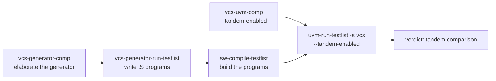

# Random tests with riscv-dv

Purpose: generate random instruction tests, run them against Spike, and
reproduce a failure.

**Prerequisites:** [getting_started.md](../getting_started.md), the UVM
flow of [uvm_testbench.md](uvm_testbench.md), and a VCS licence.

**Today the flow works with VCS only.** The generator is a SystemVerilog
program elaborated with VCS (`vcs-generator-comp`), and the macro that
chains the steps runs the tests on VCS. Recipes for an open-source
simulator, for instance Verilator, remain to be written. Once generated
and compiled, the programs are ordinary tests: `uvm-run-testlist` can
run them on another UVM simulator.

## What it is

[riscv-dv](https://github.com/chipsalliance/riscv-dv) (submodule
`verif/sim/dv`) is a SystemVerilog generator of random RISC-V programs.
CVA6 extends it in `verif/env/corev-dv` (instruction streams, settings per
ISA). The flow has three steps:

1. **generate**: the generator, a VCS simulation, writes assembly
   programs;
2. **compile**: `sw-compile-testlist` builds them;
3. **run**: `uvm-run-testlist` runs them on the UVM testbench, with Spike
   in tandem. A generated program does not check its own result: the
   tandem comparison is the verdict.



`macro-vcs-generator-testlist` runs the three steps on the right.

## The testlist of a target

The tests of a target are in `config/target/<t>/verif/generated_test.yaml`.
Today only `cv32a60x` has one. The format is the riscv-dv one:

```yaml
common_test_gen_config: &common_test_gen_config
  path_var: TESTS_GEN_PATH            # build/<t>/dv_generated
  gcc_opts: >
      -static -mcmodel=medany -fvisibility=hidden -nostdlib -nostartfiles
      -I./verif/env/corev-dv/user_extension

testlist:
  - test: riscv_load_store_test
    <<: *common_test_gen_config
    gen_test: cva6_instr_base_test_c  # generator test class
    gen_opts: >                       # generator plusargs
      +instr_cnt=500
      +directed_instr_0=cva6_load_store_rand_instr_stream_c,30
    iterations: 2                     # programs generated; 0 disables the test
    asm_tests: <path_var>/riscv_load_store_test/asm_tests/riscv_load_store_test_<iterations>.S
  - test: riscv_interrupt_test
    # ...
    run_opts: +enable_interrupt       # plusargs of the RTL run of this test
```

- `gen_test`, `gen_opts`, `iterations`: read by the generator.
- `asm_tests`, `gcc_opts`: read by `sw-compile-testlist`. `<path_var>`
  becomes `build/<t>/dv_generated`.
- `run_opts`: added to the simulation of that test by `uvm-run-testlist`.

The header of the file of `cv32a60x` lists every key.

## Run the whole flow

```bash
# 1. Elaborate the generator for the target, and the testbench with the tandem
./cook.py vcs-generator-comp -t cv32a60x
./cook.py vcs-uvm-comp -t cv32a60x --tandem-enabled

# 2. Generate, compile and run every test of the list
./cook.py macro-vcs-generator-testlist -t cv32a60x -c gcc-15 \
  -l config/target/cv32a60x/verif/generated_test.yaml --tandem-enabled
```

`vcs-generator-comp` picks the corev-dv setting (`rv32imcb`, `rv32imac`,
`rv64gc`) from the `march` of the target; `--core-setting` forces one.
The generator is in `build/cv32a60x/dv_generator/`, the programs in
`build/cv32a60x/dv_generated/<test>/asm_tests/<test>_<i>.S`.

Useful options of the macro: `-n <test>` (repeatable) for some tests only,
`--batch-size` to generate several programs per generator run,
`--trace-mode` to dump waveforms (elaborate with the same mode). See
[`macro-vcs-generator-testlist`](../../flows/README.md#macro-vcs-generator-testlist).

## Step by step

The macro chains three recipes. They can be run one by one:

```bash
./cook.py vcs-generator-run-testlist -t cv32a60x \
  -l config/target/cv32a60x/verif/generated_test.yaml
./cook.py sw-compile-testlist -t cv32a60x -c gcc-15 \
  -l config/target/cv32a60x/verif/generated_test.yaml
./cook.py uvm-run-testlist -s vcs -t cv32a60x --tandem-enabled \
  -l config/target/cv32a60x/verif/generated_test.yaml
```

`vcs-generator-run` generates one test with options given on the command
line (instruction count, extensions, directed streams), without a
testlist. See [Random Test Generation](../../flows/README.md#random-test-generation).

## Seeds: reproduce a failing test

Each generator run draws a seed, unless `--seed` gives it. The seeds are
recorded:

- `build/<t>/dv_generated/<test>/seed.yaml`: the seeds of the last
  generation of that test;
- `build/<t>/dv_generated/seedlist.yaml`: every seed, appended run after
  run.

The keys are `<test>_<batch>`. With the default batch size of 1, there is
one key per iteration, and `--seed` is the seed of the first iteration:
the next ones use `seed + 1`, `seed + 2`... To reproduce a failing
program, run its test alone with the seed recorded for it: the first
program generated then uses that seed.

```bash
./cook.py macro-vcs-generator-testlist -t cv32a60x -c gcc-15 \
  -l config/target/cv32a60x/verif/generated_test.yaml \
  -n riscv_load_store_test --seed <seed> --tandem-enabled --trace-mode gui
```

Elaborate the testbench with `--trace-mode gui` first to get the
waveforms. The UVM run also has its own seed, `--uvm-seed`, recorded in
the report of the run.

## Add generated tests to another target

1. Create `config/target/<t>/verif/generated_test.yaml`. Start from the
   one of `cv32a60x` and keep only the tests whose instructions the
   target supports (the `+enable_*_extension` options must match its
   ISA).
2. Check that `vcs-generator-comp -t <t>` finds a corev-dv setting for
   its `march`, or pass `--core-setting`.
3. Run the flow above on the target.

Nothing else to declare: `full-regression` runs the generated tests of
every target that has this file, as four more jobs (`dv-elab`,
`testlist-generate`, `generated-compile`, `generated-run` with the
tandem). See
[The full-regression macro](../../flows/CONTINUOUS_INTEGRATION.md#the-full-regression-macro).

## See also

- [uvm_testbench.md](uvm_testbench.md): the UVM testbench and the tandem
- [waveforms_and_debug.md](waveforms_and_debug.md): waveforms and seeds
- [testlists.md](testlists.md): the testlist recipes
- [flows/README.md, Random Test Generation](../../flows/README.md#random-test-generation)
- [developer/ci_checks.md](../developer/ci_checks.md): the full regression
