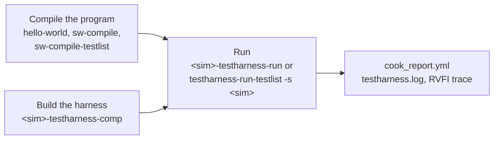

# The TestHarness

Purpose: run a program on the TestHarness of `corev_apu`, with Verilator
(no licence), VCS, Questa or Xcelium.

**Prerequisites:** [getting_started.md](../getting_started.md): Spike
installed (the harness loads the program through its libraries, even
without tandem), Verilator v5.050 for the Verilator section,
`git-dependencies` run, a toolchain in `compiler.yml`.

## What it is

The TestHarness (`corev_apu/tb/`) wraps the core in a small AXI SoC:
memory, UART, debug module. It loads the program itself. The program
ends the test by writing `tohost`: the harness prints
`*** SUCCESS ***` or `*** FAILED *** (tohost = N)`, and the recipes read
that verdict from the log and the exit code. There is no scoreboard and
no Spike tandem.

Limits, checked by the recipes before they build anything:

- **AXI targets only**: those whose `testbench_cfg.yml` declares
  `hier: axi`. An OBI target runs on the
  [UVM testbench](uvm_testbench.md) only.
- **`--comp-mode rtl` only**: the option accepts the other values for
  symmetry with the UVM recipes, and rejects them. No coverage, no
  gate-level.

The TestHarness is the testbench of the proxy kernel
([software/proxy_kernel.md](../software/proxy_kernel.md)) and of Zephyr
([software/zephyr.md](../software/zephyr.md)).

## The flow



| Step | Output |
|---|---|
| `hello-world`, `sw-compile` | `build/<t>/compile/<test>/` |
| `<sim>-testharness-comp` | `build/<t>/elab/sim_rtl_<sim>_testharness/` |
| `<sim>-testharness-run` | `build/<t>/simulation/sim_rtl_<sim>_testharness/<test>/` |

The run reads the ISA and the `tohost` address from the manifest of the
compiled program. How the verdict is read on each simulator:
[RTL Simulation: TestHarness testbench](../../flows/README.md#rtl-simulation-testharness-testbench).

## Verilator (verified, no licence)

```bash
./cook.py sw-compile-testlist -t profile_perf32_axi -c gcc-15 \
  -l verif/tests/testlist_verilator_testharness_smoke.yaml
./cook.py verilator-testharness-comp -t profile_perf32_axi
./cook.py verilator-testharness-run -t profile_perf32_axi -n hello-uart_0
```

A test compiled from a testlist is named `<test>_<iteration>`. The
Verilator of the `PATH` is used (`setenv.sh` puts the one of
`VERILATOR_INSTALL_DIR` there). `-j` sets the parallel jobs of the C++
build.

Waveforms: `--trace-mode fast` dumps a VCD, `compact` an FST, on the
build and on the run. There is no GUI mode. See
[waveforms_and_debug.md](waveforms_and_debug.md#verilator).

Options: [`verilator-testharness-comp`](../../flows/README.md#verilator-testharness-comp),
[`verilator-testharness-run`](../../flows/README.md#verilator-testharness-run).

## VCS (verified)

```bash
./cook.py hello-world -t profile_perf32_axi -c gcc-15
./cook.py vcs-testharness-comp -t profile_perf32_axi
./cook.py vcs-testharness-run -t profile_perf32_axi -n hello-world
```

`--uvm-verbosity` stays at `LOW` or above: the harness prints its verdict
at that level. Options:
[`vcs-testharness-comp`](../../flows/README.md#vcs-testharness-comp),
[`vcs-testharness-run`](../../flows/README.md#vcs-testharness-run).

## Questa (not verified)

The same commands with `questa-testharness-comp` and
`questa-testharness-run`, same options as VCS. The recipes exist but were
never run to the end of a test. The run needs a Questa whose gcc runtime
is at least the one the Spike libraries were built against. See
[`questa-testharness-comp`, `questa-testharness-run`](../../flows/README.md#questa-testharness-comp-questa-testharness-run).

## Xcelium (not verified)

The same commands with `xcelium-testharness-comp` and
`xcelium-testharness-run`, same options as VCS. The recipes exist but were
never run. See
[`xcelium-testharness-comp`, `xcelium-testharness-run`](../../flows/README.md#xcelium-testharness-comp-xcelium-testharness-run).

## A testlist

```bash
./cook.py testharness-run-testlist -s verilator -t profile_perf32_axi \
  -l verif/tests/testlist_verilator_testharness_smoke.yaml
```

`-s` is `verilator` (default), `vcs`, `questa` or `xcelium`. See
[testlists.md](testlists.md).

## See also

- [README.md](README.md): the two testbenches compared
- [uvm_testbench.md](uvm_testbench.md): the other testbench
- [software/bare_metal.md](../software/bare_metal.md): your own program
- [developer/ci_checks.md](../developer/ci_checks.md#the-ci-of-the-repository): the GitHub smoke, a TestHarness run you can replay
