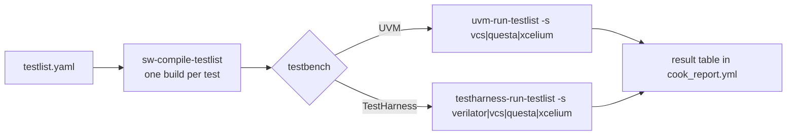

# Testlists

Purpose: compile and run many tests at once, on either testbench.

**Prerequisites:** [getting_started.md](../getting_started.md), and the
first run of your testbench: [uvm_testbench.md](uvm_testbench.md) or
[testharness.md](testharness.md).

## What a testlist is

A testlist is a YAML file, most of them in `verif/tests/`
(`base_rv32_p.yaml`, `base_rv64_p.yaml`, ...). The `base_*` lists run
riscv-tests, cloned by `git-dependencies`. Each entry names a test, its
sources (`asm_tests`), its compiler options (`gcc_opts`) and its number
of `iterations` (`0` disables it). The header of each file lists its
keys.

The compilation and the run are two recipes:



A test compiled from a testlist is named `<test>_<iteration>`, so the run
recipe must read the same testlist. `-n <test>` restricts both recipes to
one test of the list.

## One compilation, several simulators

The compiled tests do not depend on the simulator: compile the testlist
once, then run it with every simulator you have. The simulator is the
`-s` option of the run recipe:

| Testbench | Run recipe | `-s` | Elaborate first with |
|---|---|---|---|
| UVM | `uvm-run-testlist` | `vcs`, `questa`, `xcelium` (required) | `vcs-uvm-comp`, `questa-uvm-comp`, `xcelium-uvm-comp` |
| TestHarness | `testharness-run-testlist` | `verilator` (default), `vcs`, `questa`, `xcelium` | `verilator-testharness-comp`, `vcs-testharness-comp`, ... |

For instance the same testlist on VCS, then on Questa:

```bash
./cook.py sw-compile-testlist -t cv32a60x -c gcc-15 -l verif/tests/base_rv32_p.yaml
./cook.py vcs-uvm-comp -t cv32a60x
./cook.py uvm-run-testlist -s vcs -t cv32a60x -l verif/tests/base_rv32_p.yaml
./cook.py questa-uvm-comp -t cv32a60x
./cook.py uvm-run-testlist -s questa -t cv32a60x -l verif/tests/base_rv32_p.yaml
```

The output directories differ by testbench:

- **TestHarness**: one directory per simulator,
  `build/<t>/elab/sim_rtl_<sim>_testharness/` and
  `build/<t>/simulation/sim_rtl_<sim>_testharness/`. The runs of two
  simulators are kept side by side.
- **UVM testbench**: the three simulators share `build/<t>/elab/sim_rtl/`
  and `build/<t>/simulation/sim_rtl/`. Elaborating with a second
  simulator replaces the design of the first, and its runs overwrite the
  previous results. Run one simulator after the other, and keep the
  results you need before switching.

## On the UVM testbench

```bash
./cook.py sw-compile-testlist -t cv32a60x -c gcc-15 -l verif/tests/base_rv32_p.yaml
./cook.py vcs-uvm-comp -t cv32a60x
./cook.py uvm-run-testlist -s vcs -t cv32a60x -l verif/tests/base_rv32_p.yaml
```

`-s` is `vcs`, `questa` or `xcelium` (see above). The run options of `<sim>-uvm-run` apply to every
test (`--tandem-enabled`, `--trace-mode`, `--comp-mode`...). A
`run_opts` key in an entry adds plusargs to that test only. See
[`uvm-run-testlist`](../../flows/README.md#uvm-run-testlist).

## On the TestHarness

```bash
./cook.py sw-compile-testlist -t profile_perf32_axi -c gcc-15 \
  -l verif/tests/testlist_verilator_testharness_smoke.yaml
./cook.py verilator-testharness-comp -t profile_perf32_axi
./cook.py testharness-run-testlist -s verilator -t profile_perf32_axi \
  -l verif/tests/testlist_verilator_testharness_smoke.yaml
```

`-s vcs`, `-s questa` or `-s xcelium` run the same list on the other
simulators, after their `<sim>-testharness-comp`. See
[`testharness-run-testlist`](../../flows/README.md#testharness-run-testlist).

## Results

The result table is in the `cook_report.yml` of the testlist recipe.
Each test also has its own run directory, as for a single run. The
testlists the CI runs per target are in the `TESTLISTS` table of
`flows/macros/full_regression.py`.

## See also

- [generated_tests.md](generated_tests.md): testlists of random tests
- [flows/README.md, `sw-compile-testlist`](../../flows/README.md#sw-compile-testlist)
- [developer/ci_checks.md](../developer/ci_checks.md): the testlists of the CI
