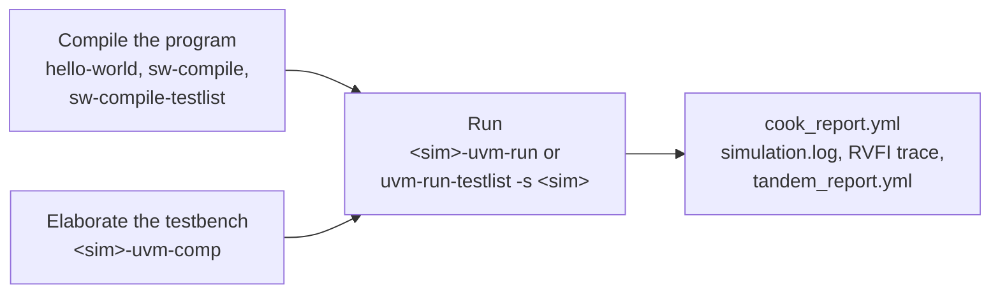

# The UVM testbench

Purpose: run a test on the UVM testbench of CVA6, with VCS, Questa or
Xcelium, with or without the Spike tandem.

**Prerequisites:** [getting_started.md](../getting_started.md) (Spike
installed, `git-dependencies` run, a toolchain in `compiler.yml`), and a
licence of the simulator.

## What it is

The UVM testbench (`verif/tb/uvmt/`, top `uvmt_cva6_tb`) wraps the core
in the UVM agents of `verif/core-v-verif`. These agents drive the memory
bus of the target, AXI or OBI, and the interrupts. A scoreboard checks
the end of the test. With the tandem, Spike, the reference model,
executes the same program and every retired instruction is compared.

It runs every target, AXI and OBI. For an OBI target, the OBI agent
randomises memory stalls, unless the run asks for
`--tb-performance-mode` (the memory then answers at once). The AXI agent
always answers without delay.

## The flow



The program is compiled once and the design is elaborated once. Any
compiled test then runs on that elaboration. The elaboration fixes some
options: `--comp-mode`, `--trace-mode`, `--tandem-enabled` and `--stats`.
The run refuses an option the elaboration was not built for, and prints
the command to rebuild it.

| Step | Output |
|---|---|
| `hello-world`, `sw-compile` | `build/<t>/compile/<test>/` |
| `<sim>-uvm-comp` | `build/<t>/elab/sim_<comp_mode>/` (`sim_rtl` by default) |
| `<sim>-uvm-run` | `build/<t>/simulation/sim_<comp_mode>/<test>/` |

Each directory holds a `cook_report.yml` (verdict, metrics). The run
directory also holds `simulation.log` and `trace_rvfi_hart_00.dasm`, the
trace of the retired instructions
([log files](../../flows/README.md#simulation-log-files-description)).

## VCS (verified)

```bash
./cook.py hello-world -t cv32a60x -c gcc-15     # build/cv32a60x/compile/hello-world/
./cook.py vcs-uvm-comp -t cv32a60x              # build/cv32a60x/elab/sim_rtl/
./cook.py vcs-uvm-run -t cv32a60x -n hello-world
```

The verdict and the cycle count are in
`build/cv32a60x/simulation/sim_rtl/hello-world/cook_report.yml`.

Specific to VCS:

- `vcs-uvm-gui` opens Verdi on the waveform of a run
  ([waveforms_and_debug.md](waveforms_and_debug.md#vcs)).
- `--sim-profile` on `vcs-uvm-comp` and `vcs-uvm-run` profiles the
  simulation.
- `macro-vcs-generator-testlist` and the riscv-dv generator exist for VCS
  only ([generated_tests.md](generated_tests.md)).

Options: [`vcs-uvm-comp`](../../flows/README.md#vcs-uvm-comp),
[`vcs-uvm-run`](../../flows/README.md#vcs-uvm-run).

## Questa (verified)

The same steps, with the Questa recipes and the same options (except
`--sim-profile`):

```bash
./cook.py hello-world -t cv32a60x -c gcc-15
./cook.py questa-uvm-comp -t cv32a60x            # vlog, then vopt
./cook.py questa-uvm-run -t cv32a60x -n hello-world
```

Waveforms are WLF files, opened with the Questa GUI
([waveforms_and_debug.md](waveforms_and_debug.md#questa)). Options:
[`questa-uvm-comp`](../../flows/README.md#questa-uvm-comp),
[`questa-uvm-run`](../../flows/README.md#questa-uvm-run).

## Xcelium (not verified)

The recipes exist and follow the VCS ones, but they were never run to the
end of a test. Expect to fix them on first use, and report what you find.

```bash
./cook.py hello-world -t cv32a60x -c gcc-15
./cook.py xcelium-uvm-comp -t cv32a60x           # xrun -elaborate
./cook.py xcelium-uvm-run -t cv32a60x -n hello-world
```

Waveforms are SHM databases
([waveforms_and_debug.md](waveforms_and_debug.md#xcelium)). Options:
[`xcelium-uvm-comp`](../../flows/README.md#xcelium-uvm-comp),
[`xcelium-uvm-run`](../../flows/README.md#xcelium-uvm-run).

## Spike tandem

With the tandem, every retired instruction is compared with Spike. A
mismatch fails the test, even if the program itself passes. Enable the
tandem at elaboration and at run, on any of the three simulators:

```bash
./cook.py vcs-uvm-comp -t cv32a60x --tandem-enabled
./cook.py vcs-uvm-run -t cv32a60x -n hello-world --tandem-enabled
```

The run directory then holds `tandem.log` (the Spike trace) and
`tandem_report.yml` (the mismatches). Spike is configured by
`config/target/<t>/spike.yaml`, which must match the RTL configuration.
The tandem exists on the UVM testbench only. `spike-run` runs a compiled
test on Spike alone.

## Coverage

`--comp-mode coverage` elaborates and runs with code coverage, in
`sim_cov` directories instead of `sim_rtl`. Use the same mode on the
`-comp` and the `-run` recipes. Merging and reporting the coverage
database is done with the tools of the simulator; there is no recipe for
it.

## A testlist

`uvm-run-testlist -s vcs|questa|xcelium` runs every test of a testlist on
one elaboration. See [testlists.md](testlists.md).

## See also

- [README.md](README.md): the two testbenches compared
- [testharness.md](testharness.md): the other testbench
- [waveforms_and_debug.md](waveforms_and_debug.md): waveforms, GUI, seeds
- [gate_level.md](gate_level.md): the same testbench on the netlist
- [flows/README.md, RTL Simulation](../../flows/README.md#rtl-simulation): every option
