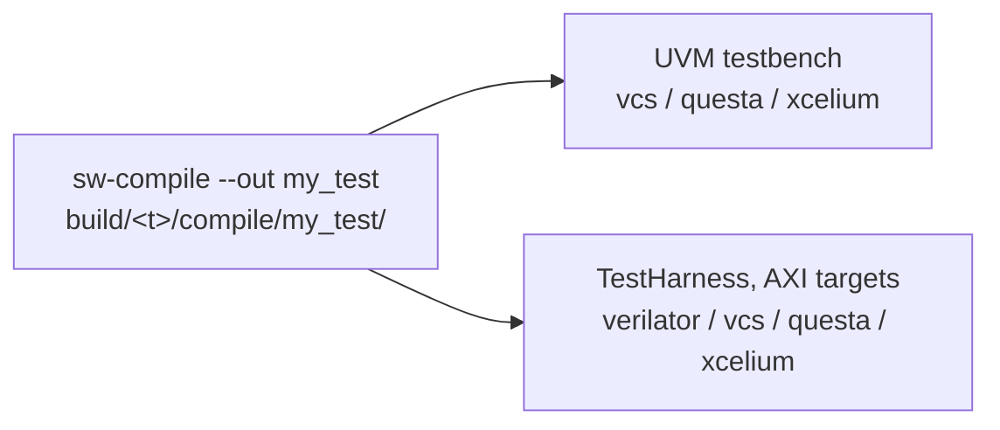

# A bare metal program

Purpose: compile your own C or assembly program for a target and run it
in simulation.

**Prerequisites:** [getting_started.md](../getting_started.md) (a
toolchain in `compiler.yml`), and one testbench:
[simulation/README.md](../simulation/README.md).

| Software | Tutorial | Simulation | Board |
|---|---|---|---|
| Bare metal | this page | UVM testbench and TestHarness, every target | yes, with the FPGA image |
| Proxy kernel (pk) | [proxy_kernel.md](proxy_kernel.md) | TestHarness, targets with U-mode and debug | no |
| Zephyr | [zephyr.md](zephyr.md) | TestHarness, `fpga_linux_*` targets | yes, Genesys 2 |
| Linux | [linux.md](linux.md) | no | yes |

## Compile

The ISA (`march`, `mabi`) comes from `config/target/<t>/isa.yml`, the
memory map from the linker script `config/target/<t>/link.ld`.
`--march` and `--mabi` override the ISA.

The start-up code and the system calls of the patterns are in
`verif/tests/custom/common/`: `crt.S` (start, then `main`) and
`syscalls.c` (`printf`, `exit`). This compiles a program the way the
`hello-world` pattern does (`flows/patterns/hello_world.py`):

```bash
./cook.py sw-compile -t cv32a60x -c gcc-15 \
  --linker config/target/cv32a60x/link.ld --out my_test \
  --inc verif/tests/custom/env --inc verif/tests/custom/common \
  --options g --options static --options mcmodel=medany --options nostartfiles \
  my_test.c verif/tests/custom/common/syscalls.c verif/tests/custom/common/crt.S
```

Each `--options x` is passed to the compiler as `-x`; `--define` and
`--inc` repeat the same way. The output is
`build/cv32a60x/compile/my_test/` (`my_test.elf`, `.dump`, `.size`).

## Run

The compiled program does not depend on the testbench nor on the
simulator: compile it once, then run it on every testbench and simulator
you have. Each run recipe takes the name given by `--out`, after the
elaboration of its testbench for the target:



| Testbench | Simulator | Elaborate | Run |
|---|---|---|---|
| UVM | VCS | `vcs-uvm-comp -t <t>` | `vcs-uvm-run -t <t> -n my_test` |
| UVM | Questa | `questa-uvm-comp -t <t>` | `questa-uvm-run -t <t> -n my_test` |
| UVM | Xcelium (not verified) | `xcelium-uvm-comp -t <t>` | `xcelium-uvm-run -t <t> -n my_test` |
| TestHarness | Verilator | `verilator-testharness-comp -t <t>` | `verilator-testharness-run -t <t> -n my_test` |
| TestHarness | VCS | `vcs-testharness-comp -t <t>` | `vcs-testharness-run -t <t> -n my_test` |
| TestHarness | Questa, Xcelium (not verified) | `questa-testharness-comp`, `xcelium-testharness-comp` | `questa-testharness-run`, `xcelium-testharness-run` |

For instance on the UVM testbench with VCS, then on the TestHarness with
Verilator (an AXI target):

```bash
./cook.py sw-compile -t profile_perf32_axi -c gcc-15 --out my_test ...   # as above
./cook.py vcs-uvm-comp -t profile_perf32_axi
./cook.py vcs-uvm-run -t profile_perf32_axi -n my_test
./cook.py verilator-testharness-comp -t profile_perf32_axi
./cook.py verilator-testharness-run -t profile_perf32_axi -n my_test
```

The TestHarness runs only on AXI targets (`hier: axi` in
`testbench_cfg.yml`). The options of each testbench:
[simulation/uvm_testbench.md](../simulation/uvm_testbench.md),
[simulation/testharness.md](../simulation/testharness.md).

**Ending the simulation.** Both testbenches stop when the program writes
the `tohost` symbol, whatever the simulator. With the start files above,
`exit()` and a return from `main` both write it with the exit code (0 is
a pass). A program that never writes `tohost` runs until the timeout.

Many programs at once: list them in a testlist and use
`sw-compile-testlist` ([simulation/testlists.md](../simulation/testlists.md)).
Every option: [`sw-compile`](../../flows/README.md#sw-compile).

## On a board

The same kind of program runs on the FPGA image: load the ELF with GDB
through OpenOCD ([fpga/README.md](../fpga/README.md#debugging)). Use the
linker script and the start files that fit the board memory map.

## See also

- [flows/README.md, Software Compilation](../../flows/README.md#software-compilation)
- [flows/README.md, Test Patterns](../../flows/README.md#test-patterns)
- [simulation/waveforms_and_debug.md](../simulation/waveforms_and_debug.md): debug the run
