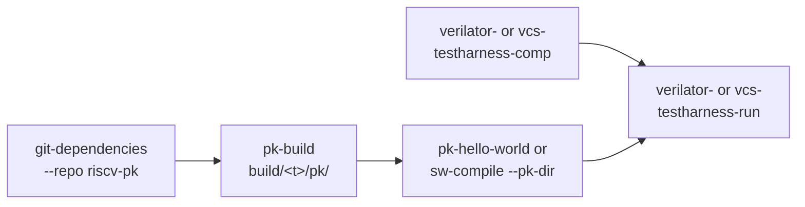

# The proxy kernel (pk)

Purpose: run a user program under the RISC-V proxy kernel, in simulation
on the TestHarness.

**Prerequisites:** [getting_started.md](../getting_started.md) (a GCC
toolchain in `compiler.yml`, Spike installed), and the TestHarness:
[simulation/testharness.md](../simulation/testharness.md).

## What it is

The [RISC-V proxy kernel](https://github.com/riscv-software-src/riscv-pk)
runs a user program and serves its system calls (`printf`, files) through
the host. pk runs in M-mode and loads the program in U-mode. Its system
calls reach the host through HTIF, which goes through the debug module of
the harness.

So pk needs:

- a target with U-mode (`RVU`) and the debug module (`DebugEn`), and the
  AXI bus: the `fpga_linux_*` targets for instance;
- the TestHarness, on **Verilator or VCS**. The Questa and Xcelium
  recipes refuse a pk test.



## Hello world

```bash
./cook.py git-dependencies --repo riscv-pk           # sources in tools/riscv-pk
./cook.py pk-build -t fpga_linux_cv32a6 -c gcc-15    # build/fpga_linux_cv32a6/pk/
./cook.py pk-hello-world -t fpga_linux_cv32a6 -c gcc-15
./cook.py verilator-testharness-comp -t fpga_linux_cv32a6
./cook.py verilator-testharness-run -t fpga_linux_cv32a6 -n pk-hello-world
```

The program prints in
`build/fpga_linux_cv32a6/simulation/sim_rtl_verilator_testharness/pk-hello-world/testharness.log`.
Hello world takes about 2.5 million cycles: about 2 minutes on Verilator,
4 on VCS.

The program is built once and runs on both simulators that support pk,
with the same test name:

| Simulator | Elaborate | Run |
|---|---|---|
| Verilator | `verilator-testharness-comp -t <t>` | `verilator-testharness-run -t <t> -n pk-hello-world` |
| VCS | `vcs-testharness-comp -t <t>` | `vcs-testharness-run -t <t> -n pk-hello-world` |

`pk-build` also builds `libpk_dtm.so`, the SimDTM library VCS loads under
pk. Each simulator has its own output directory
(`sim_rtl_<sim>_testharness`), so the runs stay side by side.

## Your own program

Compile it with `sw-compile`, an empty `--linker ""` (the default script
of the toolchain) and `--pk-dir build/<t>/pk`. The run recipes then load
pk and give it your program:

```bash
./cook.py sw-compile -t fpga_linux_cv32a6 -c gcc-15 --linker "" \
  --pk-dir build/fpga_linux_cv32a6/pk --out my_pk \
  --options g --options O2 --options static my_pk.c
./cook.py verilator-testharness-run -t fpga_linux_cv32a6 -n my_pk
```

pk is built for the `march`/`mabi` of the target: build the program for
the same ISA (the default, unless you pass `--march`/`--mabi`). The
`pk-hello-world` pattern (`flows/patterns/pk_hello_world.py`) is the
example.

## See also

- [flows/README.md, Proxy kernel](../../flows/README.md#proxy-kernel)
- [flows/README.md, `pk-build`](../../flows/README.md#pk-build),
  [`pk-hello-world`](../../flows/README.md#pk-hello-world)
- [bare_metal.md](bare_metal.md): a program without pk
