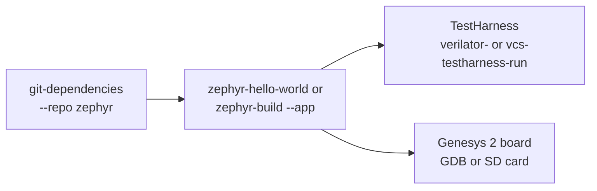

# Zephyr

Purpose: build a Zephyr application for a target, run it on the
TestHarness, then on the Genesys 2 board.

**Prerequisites:** [getting_started.md](../getting_started.md), the
Zephyr SDK toolchain (below), and the TestHarness:
[simulation/testharness.md](../simulation/testharness.md).

## What it is

Zephyr supports the CVA6 SoC of the Genesys 2 board, whose memory map is
the one of the TestHarness. `zephyr-build` builds an application with
CMake and Ninja, without west. The board follows from the target:

| Target | Zephyr board |
|---|---|
| `fpga_linux_cv32a6` (32-bit, with A) | `cv32a6_genesys_2` |
| `fpga_linux_cv64a6` (64-bit, with A, F and D) | `cv64a6_genesys_2` |

Other targets are refused. Zephyr runs in M-mode and needs no MMU.



## The toolchain

Zephyr needs the RISC-V toolchain of the
[Zephyr SDK](https://github.com/zephyrproject-rtos/sdk-ng/releases)
(`toolchain_linux-x86_64_riscv64-zephyr-elf`), declared in `compiler.yml`,
for instance as `zephyr-sdk`:

```yaml
zephyr-sdk:
    TOOLS_PATH: "/path/to/zephyr-sdk-0.17.4/riscv64-zephyr-elf"
    CLANG:
    GCC: "riscv64-zephyr-elf-gcc"
    OBJDUMP: "riscv64-zephyr-elf-objdump"
    NM: "riscv64-zephyr-elf-nm"
    TARGET_TOOLCHAIN: "riscv64-zephyr-elf"
```

A bare metal toolchain whose libgcc is not built for `-mcmodel=medany`
fails to link the 64-bit board (`relocation truncated to fit`).

## In simulation

```bash
./cook.py git-dependencies --repo zephyr               # sources in tools/zephyr
./cook.py zephyr-hello-world -t fpga_linux_cv32a6 -c zephyr-sdk
./cook.py verilator-testharness-comp -t fpga_linux_cv32a6
./cook.py verilator-testharness-run -t fpga_linux_cv32a6 -n zephyr-hello-world
```

The application is built once and runs on every simulator of the
TestHarness, with the same test name:

| Simulator | Elaborate | Run |
|---|---|---|
| Verilator | `verilator-testharness-comp -t <t>` | `verilator-testharness-run -t <t> -n zephyr-hello-world` |
| VCS | `vcs-testharness-comp -t <t>` | `vcs-testharness-run -t <t> -n zephyr-hello-world` |
| Questa, Xcelium (not verified) | `questa-testharness-comp`, `xcelium-testharness-comp` | `questa-testharness-run`, `xcelium-testharness-run` |

The CI runs `fpga_linux_cv32a6` on Verilator and `fpga_linux_cv64a6` on
VCS. Each simulator has its own output directory
(`sim_rtl_<sim>_testharness`), so the runs stay side by side.

## Your own application

A directory with its `CMakeLists.txt`. The application must define and
write `tohost` to end the simulation. The Hello world of
`verif/tests/custom/zephyr/hello_world` is the example:

```bash
./cook.py zephyr-build -t fpga_linux_cv32a6 -c zephyr-sdk \
  --app path/to/my_app --out my_app
./cook.py verilator-testharness-run -t fpga_linux_cv32a6 -n my_app
```

The output is laid out as the one of `sw-compile`, so the run recipes
take the test name. See [`zephyr-build`](../../flows/README.md#zephyr-build).

## On the board

The same build runs on the Genesys 2 board, loaded through OpenOCD and
GDB or booted from the SD card:
[fpga/README.md, Zephyr on the board](../fpga/README.md#zephyr-on-the-board).

## See also

- [flows/README.md, `zephyr-hello-world`](../../flows/README.md#zephyr-hello-world)
- [bare_metal.md](bare_metal.md): a program without an OS
