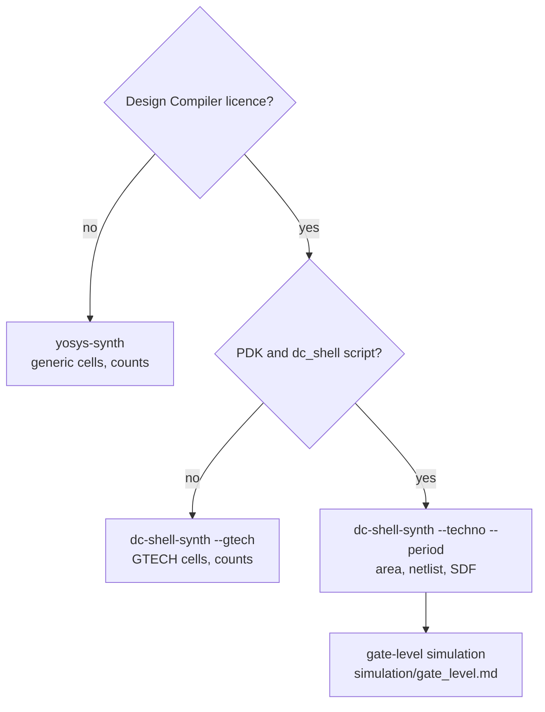

# Choose a synthesis flow

Purpose: pick the synthesiser and the cell library that fit your
question: a quick size estimate, a figure comparable over time, or a real
netlist on your technology.

**Prerequisites:** [getting_started.md](../getting_started.md). The
synthesis file list of a target is described in
[integration/integrator.md](../integration/integrator.md#collect-the-files-the-flist).

Two synthesisers, each on generic cells or on a real library:

| Synthesiser | Generic cells (no PDK) | Real PDK |
|---|---|---|
| Yosys (`yosys-synth`) | internal Yosys cells: cell and register counts. No licence. | not available in the recipe yet |
| Design Compiler (`dc-shell-synth`) | `--gtech`: GTECH cells, with `pd/synth/gtech_dc.tcl`: cell and register counts | `--techno --period`, with your own `dc_shell` script: area, netlist, SDF |



Common points:

- The generic flows read `config/target/<t>/Flist.cva6_synth`, where the
  HPDcache SRAMs are blackbox models, and elaborate the example top of the
  target (`cva6_example_axi` or `cva6_example_obi`).
- The hierarchy is kept, so the counts are given per block and are higher
  than those of a flat synthesis.
- Any inferred latch fails the generic syntheses.
- The figures are compared with the baselines of
  `config/target/<t>/expected_values.yml`, 5 % tolerance. A missing key
  skips the check.

| Flow | Tutorial | Keys of `expected_values.yml` | Output |
|---|---|---|---|
| `yosys-synth` | [yosys.md](yosys.md) | `yosys_cells`, `yosys_registers` | `build/<t>/synthesis_yosys/` |
| `dc-shell-synth --gtech` | [dc_shell.md](dc_shell.md#gtech-no-pdk) | `gtech_cells`, `gtech_registers` | `build/<t>/synthesis_gtech/` |
| `dc-shell-synth --techno` | [dc_shell.md](dc_shell.md#on-your-pdk) | `gates` (NAND2 equivalents) | `build/<t>/synthesis/` |

## Area baselines

When a change of the RTL moves the area on purpose, update the key in the
same commit and explain why. The list of keys:
[expected_values.yml](../../config/README.md#expected_valuesyml).

## Spyglass lint

Spyglass lints the RTL of a target against
`config/target/<t>/expected_spyglass.rpt`:

```bash
./cook.py spyglass-design-read -t cv32a60x
./cook.py spyglass-run -t cv32a60x
```

`--run-type gui` opens the GUI. See
[Static Analysis](../../flows/README.md#static-analysis). Without a
licence, `rtl-lint` (slang and Verilator) covers every target
([developer/ci_checks.md](../developer/ci_checks.md#lint)).

## See also

- [simulation/gate_level.md](../simulation/gate_level.md): simulate the netlist
- [flows/README.md, Synthesis](../../flows/README.md#synthesis)
