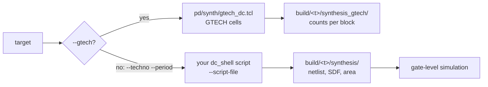

# Synthesis with Design Compiler

Purpose: synthesise a target with Design Compiler, either on the GTECH
generic cells (no PDK) or on your technology library (area, netlist,
SDF).

**Prerequisites:** [getting_started.md](../getting_started.md),
`dc_shell` in the `PATH` and a Design Compiler licence. For a PDK: the
library declared in `techno.yml` and your own `dc_shell` script (see
below).

One recipe, `dc-shell-synth`, two modes:



## GTECH (no PDK)

```bash
./cook.py dc-shell-synth -t cv32a60x --gtech
```

The script is provided: `pd/synth/gtech_dc.tcl`. It maps the design on
the GTECH cells and DesignWare operators shipped with `dc_shell`, hierarchy
kept. It reads `config/target/<t>/Flist.cva6_synth` (HPDcache SRAMs as
blackboxes) and elaborates the example top of the target.

GTECH cells have no area: the recipe reports cell and register counts,
total and per block, compared with `gtech_cells` and `gtech_registers` of
`expected_values.yml` (5 % tolerance). A latch fails the run.

Output in `build/cv32a60x/synthesis_gtech/`: `synthesis.log`,
`reports/` (`synth_area.rpt`, `synth_reference.rpt`, `check_design.rpt`,
`check_design_full.rpt`) and `netlist/synth.v`, a GTECH netlist (not for
gate-level simulation). `--techno` and `--period` are not used in this
mode.

## On your PDK

```bash
./cook.py dc-shell-synth -t cv32a60x --techno <techno> --period 5.0 \
  --script-file /path/to/my_dc.tcl
```

The repository does not ship a Design Compiler flow for a real library.
You provide the top Tcl script of `dc_shell`; the recipe gives it the
design and the technology, then collects and checks its outputs.

### Inputs you give

| Input | How |
|---|---|
| The technology | an entry of `$CONFIG_DIR/techno.yml`, selected by `--techno` ([keys](../../flows/README.md#techno-configuration-technoyml)) |
| The clock period, in ns | `--period` |
| Your `dc_shell` script | `--script-file`, an absolute path. A relative name (the default is `dc.tcl`) is looked up in the `rm_dc_scripts/` subdirectory of the working directory below. |
| Preprocessor defines | `--define` (`HPDCACHE_ASSERT_OFF` by default, `RVFI_ENABLE`) |

The recipe runs:

```
dc_shell -no_gui -no_log -topographical_mode -f <script>
```

Topographical mode needs the physical libraries of your PDK.

**Working directory.** `dc_shell` runs in a fixed directory of the
checkout, set in `flows/recipes/dc_shell_synth.py` and not shipped by the
repository. Create it once (or link it to your site flow) before the
first run: the recipe writes its file list there and does not create the
directory.

### What the recipe gives to your script

**A file list.** The recipe writes `Flist.cva6_synth` in the working
directory of `dc_shell` (overwritten at each run). It holds one line per source file:

```
analyze -f sverilog -lib ariane_lib -define { HPDCACHE_ASSERT_OFF } /abs/path/file.sv
```

The files come from `config/target/<t>/Flist.cva6_synth` (HPDcache SRAMs as blackboxes), with its `-F`
includes followed and its placeholders expanded. Your script runs it
(`source Flist.cva6_synth`), then elaborates `$env(TOP_ELABORATE)`.

**Environment variables**, read with `$env(NAME)`:

| Variable | Value |
|---|---|
| `TOP` | `cva6`: prefix of the output file names |
| `TOP_ELABORATE` | the design to elaborate: `cva6_example_axi` or `cva6_example_obi`, from `testbench_cfg.yml` |
| `TOP_SYNTHESIS` | `cva6_top__*` |
| `CVA6_TYPE` | `HPDCACHE` on an AXI target (HPDcache subsystem), empty on an OBI target |
| `TARGET`, `TARGET_CFG` | the target name |
| `CVA6_REPO_DIR` | root of the checkout |
| `HPDCACHE_DIR` | `$CVA6_REPO_DIR/core/cache_subsystem/hpdcache` |
| `PERIOD` | the value of `--period` |
| `TOP_LIB` | `ariane_lib`, the library of the `analyze` commands |
| `LIST_FF`, `LIST_CKG`, `FF_DETAILS`, `FAST_SYNTH` | `ON`, `OFF`, `OFF`, `OFF`: switches your script may honour |
| `IP_LIST`, `DC_FILE`, `SCRIPTS_DIR` | empty |
| `SNPSLMD_QUEUE` | `TRUE`: wait for a licence instead of failing |
| every key of the `techno.yml` entry | `NAND2_AREA`, `FOUNDRY_PATH`, `LIB_NAME`, `TECH_NAME`, `CORNER_SYNTH`, `SCENARIO_SYNTH_NAME`, `CORNER_POWER`, `SCENARIO_POWER_NAME`, `LIB_VERILOG`, `FOUNDRY_RAM_PATH`, and any key you add |

The output directory is not passed: it is
`$CVA6_REPO_DIR/build/$TARGET/synthesis/`. The recipe empties it before
the run (unless `--no-clean`).

### What your script must write

Under `build/<t>/synthesis/`, with `<base>` =
`${TOP}_${TARGET}_${TECH_NAME}_synth`:

| File | Content |
|---|---|
| `netlist/<base>.v` | the netlist |
| `netlist/<base>.<SCENARIO_SYNTH_NAME>.sdf` | SDF of the timing corner |
| `netlist/<base>.<SCENARIO_POWER_NAME>.sdf` | SDF of the power corner |
| `netlist/<base>.<SCENARIO_POWER_NAME>.spef` | parasitics of the power corner |
| `reports/<base>_area.rpt` | `report_area -hierarchy` |

A missing file is an error. In the log, a line starting with `Error:` or
`RM-Error` fails the run; licence errors are reported as environment
failures. The run has a 6000 s timeout.

### What the recipe adds

From these files, the recipe writes, in `build/<t>/synthesis/` (module
names `${TOP}__<n>` renamed `${TOP}`, that is `cva6__<n>` renamed `cva6`):

- `netlist/synth.v`, `netlist/wc_timing.sdf`, `netlist/wc_power.sdf`,
  `netlist/wc_power.spef`;
- `reports/synth_area.rpt`, and `synth_area.csv` and `synth_area.html`,
  an area chart per block;
- `Flist.libverilog`, the `LIB_VERILOG` of the techno: the cell models of
  the gate-level simulation;
- `build_config.yaml`, the techno entry used.

The total area divided by `NAND2_AREA` gives the size in gates, compared
with the `gates` key of `expected_values.yml` (5 % tolerance).

The netlist then runs on the UVM testbench:
[simulation/gate_level.md](../simulation/gate_level.md).

## See also

- [README.md](README.md): the synthesis flows compared
- [`dc-shell-synth`](../../flows/README.md#dc-shell-synth): the options
- [developer/ci_checks.md](../developer/ci_checks.md): `full-regression --techno`
